<div align="center">
  
</div>

<br />

<p align="center">
  <a href="https://www.linkedin.com/in/alen-c-francis-0b6981372"></a>
  <a href="https://github.com/AlenCFrancis"></a>
  <a href="mailto:alencfrancis@gmail.com"></a>
  
</p>


## 🖥️ `whoami`

```ts
// alen.config.ts
const alen = {
  role:      "Computer Science Engineering Student",
  location:  "Kerala, India 🇮🇳",
  obsessions: ["Quantum Computing", "Multi-Agent AI", "Machine Learning", "Data Science"],
  currentlyBuilding: "agents that reason, collaborate & adapt",
  superpower: "connecting research ideas to real-world impact",
  funFact:   "I think in qubits, but I ship in Python ⚛️🐍",
  openTo:    ["collabs", "research", "hackathons", "wild ideas"],
} as const;
```


## 🎯 Current Focus

<table align="center">
  <tr>
    <td align="center" width="25%">
      <h3>⚛️</h3>
      <b>Quantum Computing</b><br />
      <sub>Circuit-based problem solving & quantum-inspired optimization</sub>
    </td>
    <td align="center" width="25%">
      <h3>🤖</h3>
      <b>Multi-Agent AI</b><br />
      <sub>Collaborative architectures & autonomous workflows</sub>
    </td>
    <td align="center" width="25%">
      <h3>✨</h3>
      <b>GenAI & LLMs</b><br />
      <sub>LLM pipelines & intelligent automation</sub>
    </td>
    <td align="center" width="25%">
      <h3>📈</h3>
      <b>ML & Analytics</b><br />
      <sub>Model experimentation & data-driven insights</sub>
    </td>
  </tr>
</table>


## 🛠️ Tech Arsenal

<details open>
<summary><b>🧪 AI, ML & Data Science</b></summary>
<br />

<p>
  
</p>


</details>

<details open>
<summary><b>🤖 Multi-Agentic & AI Systems</b></summary>
<br />


</details>

<details open>
<summary><b>⚛️ Quantum Computing</b></summary>
<br />


</details>

<details open>
<summary><b>🌐 Web & Data Platforms</b></summary>
<br />

<p>
  
</p>

</details>

<details open>
<summary><b>🔌 Embedded Systems & IoT</b></summary>
<br />

<p>
  
</p>


</details>


## 📊 GitHub Analytics

<div align="center">
  
  
</div>

<br />

<div align="center">
  
</div>


## 💭 Vision

<div align="center">
  
</div>


## 🤝 Let's Connect

I'm open to collaborations, learning opportunities, and projects involving:

| ⚛️ Quantum | 🤖 Agents | ⚙️ Automation | 🧠 ML | 📊 Data |
|:---:|:---:|:---:|:---:|:---:|
| Research & experimentation | Multi-agent AI systems | Smart, applied AI | Real-world ML apps | Analytics solutions |

<p align="center">
  <a href="https://www.linkedin.com/in/alen-c-francis-0b6981372"></a>
  <a href="mailto:alencfrancis@gmail.com"></a>
</p>


<p align="center"><sub>⚛️ built with curiosity, qubits & a lot of ☕</sub></p>
